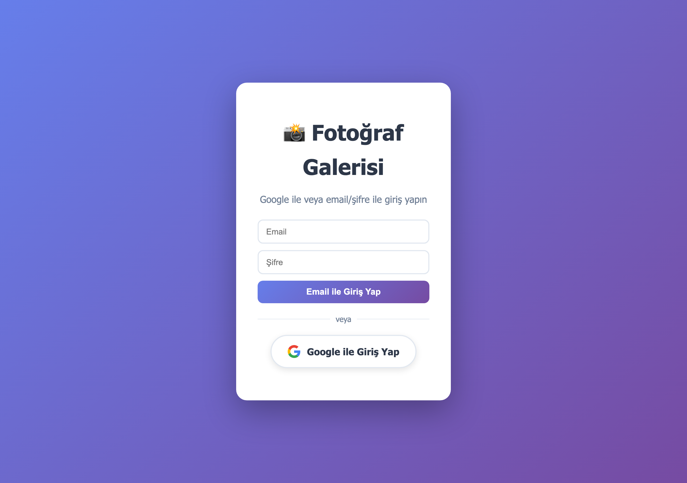

# 📸 Photo Gallery

> A self-hosted photo gallery in Docker: Google or email login, education-based albums, drag-free uploads, lightbox viewing and persistent storage.

[](https://www.docker.com/)
[](https://expressjs.com/)
[](LICENSE)

<p align="center">
  <a href="https://www.buymeacoffee.com/cmtrkr"></a>
</p>

Photo Gallery is a compact Express application for hosting school or team photo albums on your own server. Users sign in with Google OAuth or a local email/password account, upload photos into named albums ("eğitimler"), browse them in a responsive grid with a lightbox, and delete their own uploads. Everything runs in one container and survives restarts through a Docker volume.

## 📸 Screenshot

<p align="center">
  
  <br>
  <sub>The real login screen: local email/password or Google sign-in.</sub>
</p>

## ✨ Features

- 🔐 **Two login paths** — Google OAuth 2.0 and local email/password accounts.
- 🗂️ **Albums per education** — photos are grouped into education/album names.
- ⬆️ **Multi-file upload** — 5 MB per-file limit, type and size validation.
- 🖼️ **Lightbox viewer** — keyboard-friendly full-size previews.
- 🗑️ **Photo deletion** — authenticated users can remove photos they are allowed to manage.
- 👥 **User and access management** — admin screens for allowed users, roles and system accounts.
- 🐳 **Docker-first** — `Dockerfile` + `docker-compose.yml`, named volume for uploads.
- ♻️ **Persistent data** — container rebuilds do not lose photos.

## 🚀 Quick start

### Docker (recommended)

```bash
git clone https://github.com/cmtrkr83/photo-gallery.git
cd photo-gallery

# Create your environment file
cp .env.example .env   # if present; otherwise create .env as shown below
docker compose up -d --build
```

Open `http://<server-ip>:3000`.

Example `.env`:

```dotenv
PORT=3000
SESSION_SECRET=replace-with-a-long-random-string
GOOGLE_CLIENT_ID=your-google-client-id
GOOGLE_CLIENT_SECRET=your-google-client-secret
GOOGLE_CALLBACK_URL=http://localhost:3000/auth/google/callback
```

Google OAuth is optional. For a purely local setup, create users through the admin/local-user flow.

### Local development

```bash
npm install
npm run dev    # nodemon
npm start      # node server.js
```

## 📁 Project structure

```text
photo-gallery/
├── server.js              # Express app, auth, upload and gallery API
├── Dockerfile
├── docker-compose.yml
├── public/
│   ├── index.html         # Gallery UI
│   ├── styles.css
│   └── app.js
└── uploads/               # Uploaded photos (Docker volume in production)
```

## 🔌 API

| Method | Endpoint | Description |
| --- | --- | --- |
| `GET` | `/api/egitimler` | List albums (authenticated) |
| `GET` | `/api/photos/:egitimAdi` | List photos in an album |
| `GET` | `/api/photos` | List all photos |
| `POST` | `/api/upload` | Upload one or more photos |
| `DELETE` | `/api/photos/:egitimAdi/:filename` | Delete a photo |
| `GET` | `/api/user` | Current user |
| `POST` | `/api/auth/local-login` | Email/password login |
| `POST` | `/api/logout` | End the session |

## 🐳 Docker operations

```bash
docker compose up -d          # start
docker compose logs -f        # logs
docker compose down           # stop
docker compose build --no-cache
docker volume ls              # inspect volumes
```

Back up the upload volume:

```bash
docker run --rm -v photo-gallery-uploads:/data -v "$PWD":/backup alpine \
  tar czf /backup/photo-gallery-backup.tar.gz -C /data .
```

## 🔐 Security notes

- Set a strong `SESSION_SECRET`; never commit `.env`.
- Use HTTPS behind a reverse proxy (Caddy, Nginx, Cloudflare Tunnel).
- Restrict Google OAuth to your domain where possible.
- Keep the 5 MB upload limit and validate file types.
- Take regular backups of the uploads volume.
- The default session secret and admin token in the code are development fallbacks — change them in production.

## ❤️ Support

If Photo Gallery is useful to you, you can buy me a coffee:

<p align="center">
  <a href="https://www.buymeacoffee.com/cmtrkr"></a>
</p>

## 📄 License

[MIT](LICENSE) © 2026 Cem Türker.
